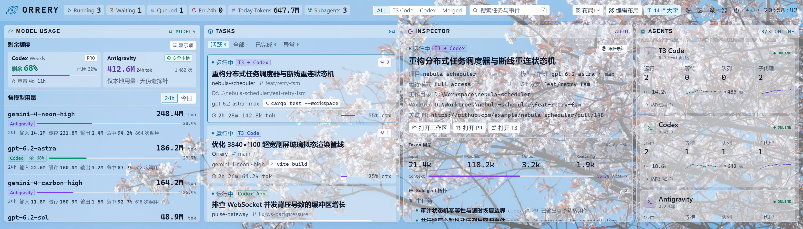
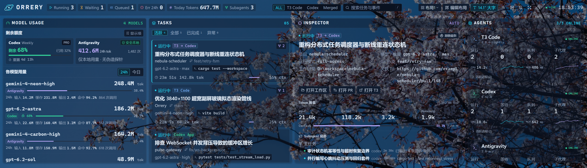

# Orrery

<p>
  <a href="LICENSE"></a>
  <a href="https://github.com/Decision2016/Orrery/releases"></a>
  
  
  
  
</p>

English | [简体中文](README.zh-CN.md)

A local-first AI Agent monitor and customizable **GridStack.js** dashboard designed for **3840×1100** ultrawide secondary displays.
Orrery passively monitors locally running **T3 Code**, **Codex** (Desktop App & CLI), and **Antigravity** sessions in real time, displaying live tasks, subagent topology trees, per-model token usage, remaining quotas, and OS process telemetry without forging upstream API requests.



*Light-mode preview on a 14.1" 3840×1100 display with custom frosted-glass background, 2×2 quota cards, active tasks, subagent topology inspector, and live agent process cards.*



*Dark-mode preview of the same 24×10 GridStack layout.*

Orrery ships as a **single unified Windows desktop application (`Orrery.exe`)** powered by Tauri v2 that embeds the web dashboard and manages the local Node telemetry engine automatically in the background (with zero console windows and Windows Job Object cleanup on exit). It also exposes `http://127.0.0.1:4318` for optional browser viewing.

## Features

- **Zero-invasive read-only collection**: opens T3 Code and Codex SQLite WAL databases in strict read-only mode (`node:sqlite` + `busy_timeout`) and incrementally tails Codex `rollout-*.jsonl` and Antigravity `transcript.jsonl` files—never locks databases and never sends forged upstream probes.
- **Cross-source deduplication (`T3 → Codex`)**: joins T3 Code runs and Codex native thread IDs into unified task records, combining T3 approvals, project/branch metadata, and subagent trees with Codex step-level tool and token telemetry.
- **Per-model usage & remaining quotas**: aggregates 24h / today token breakdowns (input, cache read, output, cache hit ratio, call counts) across Antigravity, Codex, and T3 caches, alongside passive Codex remaining-quota windows, custom API detection, and per-card visibility toggles.
- **24×10 GridStack.js customizable dashboard**: lock/edit mode toggle, drag-and-resize across 12 modular widgets (Model Usage, Daily Token Activity, Active Tasks, Task & Subagent Inspector, Agent Instances, Attention Alerts, Concurrent Swimlane Timeline, Queue & Automations, Agent TODO List, Live Event Stream, Token Burn Chart, Quota & Host), plus multi-preset persistence.
- **12-month Daily Token Activity (`TOKEN ACTIVITY`)**: Codex-style daily / weekly / cumulative token activity heatmap across the trailing 12 months with top-right Provider switching (`All`, `OpenAI`, `Gemini`, `Claude`, `DeepSeek`, etc.), 7 preset color themes + custom hex color picker, and Orrery local-first accounting with automatic provider history sync.
- **Agent-writable TODO List**: dedicated `TODO LIST` widget styled alongside `QUEUE & CRON` so any local AI Agent can create, update, or batch-sync task checklists in real time via `http://127.0.0.1:4318/api/todos`, `~/.orrery/todos.json`, or `node scripts/orrery-todo.mjs`.
- **14.1" 3840×1100 ergonomics**: viewport-locked zero-scroll canvas with `ResizeObserver` dynamic row height for 100% / 125% / 150% / 175% DPI scaling, plus 3-tier readable font scaling (`标准字号` / `14.1" 大字` / `远距超大`) and Dark / Light theme switching.
- **Custom background & live glass opacity**: supports solid themes, 4 built-in ultrawide panoramic presets, or local custom images (up to 25 MB, stored in `~/.orrery/`), with real-time sliders for panel opacity, HUD opacity, backdrop blur, and scrim contrast.
- **Secondary display lock & virtual desktop pinning (Windows)**: automatically snaps borderless fullscreen to the `3840×1100` secondary monitor, remembers your chosen display by Win32 device ID, and stays pinned across Windows 10/11 virtual desktop switches (`Win + Ctrl + ← / →`) via `WS_EX_TOOLWINDOW`.
- **Process lifecycle & tray controls**: system tray menu for monitor selection, taskbar coverage, always-on-top, autostart, and exit; top-right power menu to hide or quit cleanly; plus allowlisted per-process termination on agent cards.

## Supported agents & data sources

| Agent | Local Data Sources (Read-Only) | Telemetry Collected |
| :--- | :--- | :--- |
| **T3 Code** | `~/.t3/userdata/statev2.sqlite`, `server-runtime.json`, `usage-scan-cache-v17.json`, `~/.t3/caches/*.json` | Active & recent runs, tool steps, pending approvals/inputs, subagent trees, scheduled tasks, cached quotas, event stream |
| **Codex** (App & CLI) | `~/.codex/state_5.sqlite`, `sqlite/codex.db`, `queue_1.sqlite`, `logs_2.sqlite`, `sessions/**/*.jsonl` | Active turns, spawn edges, queued items, automations, rollout tool/token telemetry, passive `rate_limits` remaining %, WARN/ERROR logs |
| **Antigravity** | `~/.t3/userdata/providers/antigravity/*/antigravity-acp/brain/**/transcript.jsonl`, `~/.gemini/antigravity/brain/**` | Passive per-model 24h & today token usage (input / cache read / output / calls) with zero upstream probes |
| **OS Processes** | Windows CIM / Process telemetry | PID, role, CPU%, working-set memory (MB), stale-run cross-checking, allowlisted process stop |
| **Claude Code / OpenCode** | `~/.claude`, `~/.opencode` (extensible adapter registry) | Local session detection & custom API usage cache |

## Installation

### Option 1: Windows Desktop Release (recommended)

1. Download **`Orrery_0.0.1_x64-setup.exe`** (installer) or **`Orrery_0.0.1_x64-portable.zip`** (portable bundle) from [Releases](https://github.com/Decision2016/Orrery/releases).
2. Run the installer (or extract the portable zip keeping `orrery.exe` beside its `resources/` folder) and launch **Orrery**.
3. Orrery automatically starts its bundled Node telemetry engine in the background, snaps to your `3840×1100` secondary display, and adds a system tray icon.

### Option 2: Local Service + Browser Fullscreen

Requires **Node.js 24+** (uses built-in `node:sqlite`):

```powershell
npm ci
npm run build
.\scripts\start-orrery.ps1          # Starts service + snaps borderless fullscreen to 3840x1100
.\scripts\start-orrery.ps1 -NoBrowser  # Starts local service only at http://127.0.0.1:4318
```

## Controls & Tray Menu

| Control | Action |
| :--- | :--- |
| `/` | Focus search bar (tasks & events) |
| Top HUD `编辑布局` / `锁定布局` | Toggle GridStack drag, resize, add/remove widgets, and preset saving |
| Top HUD `14.1" 大字` | Cycle readable typography scale (`标准字号` / `14.1" 大字` / `远距超大`) |
| Top HUD `Sun / Moon` | Toggle Dark / Light theme |
| Top HUD `Image` | Open live Custom Background & Glass Opacity panel |
| Top HUD `Power` | Hide to system tray or shut down Orrery and its managed backend |
| System Tray | Choose target monitor, snap to display, toggle cross-virtual-desktop pinning, taskbar coverage, always-on-top, autostart, or quit |

## Configuration

Orrery stores all user preferences cleanly under `%USERPROFILE%\.orrery\`:

- `layouts.json` — custom GridStack presets and widget coordinates
- `appearance.json` & `wallpaper.<ext>` — custom background image and glass transparency settings
- `todos.json` — Agent-writable task checklist hot-reloaded every second (also writable via `POST / PATCH / PUT http://127.0.0.1:4318/api/todos` or `node scripts/orrery-todo.mjs`)
- `token-activity.json` — persistent daily / per-provider token activity ledger & incremental sync checkpoints
- `window.json` — desktop monitor lock and virtual desktop pinning preferences:

```jsonc
{
  "target_monitor_device": "\\\\.\\DISPLAY3",
  "pin_across_desktops": true,
  "cover_taskbar": true,
  "always_on_top": false,
  "autostart": false,
  "server_port": 4318
}
```

Environment variables for custom paths or ports when running the standalone Node server: `ORRERY_HOST`, `ORRERY_PORT`, `ORRERY_T3_DIR`, `ORRERY_CODEX_DIR`, `ORRERY_DATA_DIR`, `ORRERY_POLL_MS`.

## Building & Testing

Requires **Node.js 24+** and **Rust 1.85+ / Cargo** (for the Tauri v2 desktop bundle):

```powershell
npm ci
npm run build     # Builds @orrery/shared, @orrery/server, and @orrery/web
npm test          # Runs all 32 server, adapter, reconciler, and API tests
```

Build the Windows desktop executable and NSIS installer (bundles a standalone Node runtime automatically):

```powershell
cd src-tauri
cargo test        # Runs all 9 Rust desktop tests
cd ..
npx @tauri-apps/cli@2 build
```

Release artifacts are produced in `src-tauri/target/release/orrery.exe` (with adjacent `resources/`) and `src-tauri/target/release/bundle/nsis/Orrery_0.0.1_x64-setup.exe`.

## Known limitations

- **Antigravity official remaining quota %**: Antigravity does not persist official 5-hour / weekly remaining percentages to local files or expose a documented public CLI query. To protect account safety, Orrery never sends forged `v1internal` upstream requests and reports Antigravity's exact local token usage only.
- **Custom API providers**: Providers configured against custom pay-as-you-go APIs (such as Claude Code backed by `api.deepseek.com`) do not have fixed subscription quotas and are hidden from the Remaining Quota grid by default (toggleable via **显示项**).
- **Desktop shell platform**: Multi-monitor Win32 snapping, `WS_EX_TOOLWINDOW` virtual-desktop pinning, and Job Object backend management target **Windows 10 / 11**. The Node server and web UI remain platform-agnostic.

## License

Licensed under the [MIT License](LICENSE).
