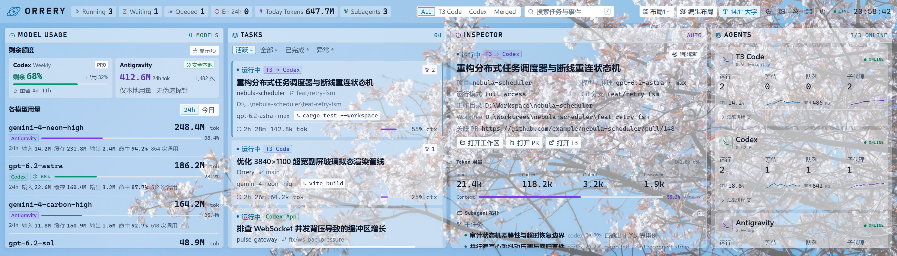
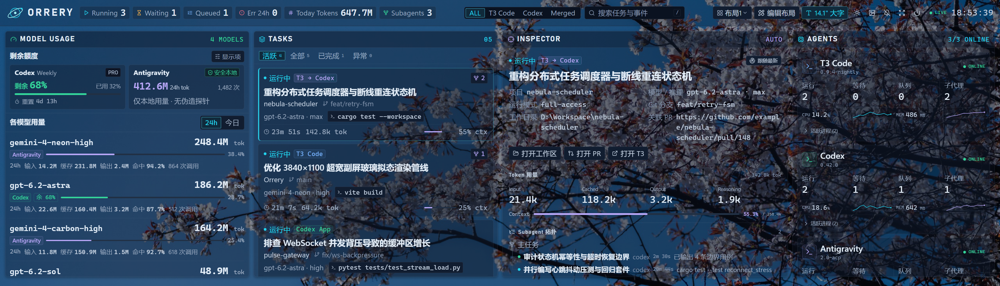

# Orrery

<p>
  <a href="LICENSE"></a>
  <a href="https://github.com/Decision2016/Orrery/releases"></a>
  
  
  
  
</p>

[English](README.md) | 简体中文

专为 **3840×1100 超宽副屏** 打造的本地 AI Agent 运行监视台，支持 **GridStack.js** 自由网格布局。
Orrery 以纯本地只读方式实时观测 **T3 Code**、**Codex**（Desktop App & CLI）与 **Antigravity** 的运行状态、Subagent 派生态树、各模型 Token 用量、剩余额度以及本机进程负载，全程零外部伪造请求。



*14.1 寸 3840×1100 浅色模式预览：自定义磨砂玻璃背景、2×2 剩余额度卡片、运行中任务、焦点任务与 Subagent 拓扑树以及 Agent 实例状态。*



*同一 24×10 GridStack 布局下的深色模式预览。*

Orrery 提供基于 Tauri v2 的**单程序一体化 Windows 桌面版（`Orrery.exe`）**：内嵌前端界面，启动时以无黑窗方式自动托管本地 Node 采集服务，并绑定 Windows Job Object（退出时自动回收子进程，绝无残留），同时支持通过 `http://127.0.0.1:4318` 在浏览器中访问。

## 核心特性

- **零侵入只读采集**：基于 Node 24 原生 `node:sqlite` 以只读模式接入 T3 Code / Codex WAL 数据库，按字节偏移增量尾读 Codex `rollout-*.jsonl` 与 Antigravity `transcript.jsonl`，不锁库、不伪造任何上游 API 探针。
- **跨源去重合并（`T3 → Codex`）**：通过原生线程 ID 自动关联 T3 Code 拉起的 Codex 会话并合并为单条任务，同时保留 T3 的审批/项目/子代理树与 Codex 的细粒度工具及 Token 遥测。
- **各模型用量与剩余额度专栏**：聚合 Antigravity、Codex、Claude/DeepSeek 等模型 24h / 今日用量（输入、缓存读取、输出、缓存命中率、调用次数），结合 Codex 被动落盘的剩余额度与重置倒计时，支持自定义 API 识别与卡片显示开关。
- **24×10 GridStack.js 自由编排**：支持锁定/编辑双模式、自由拖拽缩放与增删 12 个监控组件（各模型用量与剩余量、每日 Token 活动统计、运行中任务、焦点任务与拓扑、Agent 实例、待人工介入、并发泳道时间线、队列与定时、Agent 待办清单、实时事件流、Token 速率图、配额与主机资源），支持保存多套自定义预设。
- **12 个月每日 Token 活动热力图（TOKEN ACTIVITY）**：支持 `每天 / 每周 / 累计总量` 三种视图展示近 12 个月 Token 消耗趋势，右上角支持切换 `OpenAI`、`Gemini`、`Claude`、`DeepSeek` 等 Provider，内置 7 款主题色阶与任意自定义取色器，数据优先由 Orrery 本地实时统计并自动从各 Provider 本地缓存与会话历史同步补齐。
- **Agent 可写入待办清单（TODO LIST）**：与 `QUEUE & CRON` 保持一致的高可读行布局，支持本地任意 Agent 通过 `http://127.0.0.1:4318/api/todos`、直写 `~/.orrery/todos.json` 或调用 `node scripts/orrery-todo.mjs` 实时同步任务待办与完成状态，并内置一键复制 Agent 接入说明。
- **14.1 寸 3840×1100 副屏深度适配**：零主滚动视口锁定 + `ResizeObserver` 动态行高（完美兼容 100% / 125% / 150% / 175% 缩放），内置三档字号切换（`标准字号` / `14.1" 大字` / `远距超大`）与 Dark / Light 双主题切换。
- **自定义背景与界面毛玻璃透明度**：支持纯色默认、4 款内置广角壁纸或上传本地高清图片（≤ 25 MB，存盘于 `~/.orrery/`），支持实时调节面板不透明度、顶栏不透明度、毛玻璃模糊强度与背景遮罩浓度。
- **指定副屏锁定与跨虚拟桌面常驻（Windows）**：启动自动无边框真全屏贴合 `3840×1100` 副屏，按 Win32 显示器设备 ID 持久化记忆目标屏，并通过公开 Win32 `WS_EX_TOOLWINDOW` 机制在 Windows 10/11 切换多虚拟桌面（`Win + Ctrl + ← / →`）时保持固定显示。
- **系统托盘与进程控制**：托盘右键可切换目标副屏、覆盖/避让任务栏、跨虚拟桌面固定、始终置顶与开机自启；顶栏右上角提供一键隐藏/彻底关闭进程按钮；Agent 卡片支持展开活跃进程并二次确认安全结束白名单 PID。

## 支持的 Agent 与本地数据源

| Agent | 只读本地数据源 | 采集内容 |
| :--- | :--- | :--- |
| **T3 Code** | `~/.t3/userdata/statev2.sqlite`、`server-runtime.json`、`usage-scan-cache-v17.json`、`~/.t3/caches/*.json` | 活跃与历史任务、工具步骤、待审批/待回答告警、Subagent 派生态树、定时任务、缓存配额、事件流 |
| **Codex**（App & CLI） | `~/.codex/state_5.sqlite`、`sqlite/codex.db`、`queue_1.sqlite`、`logs_2.sqlite`、`sessions/**/*.jsonl` | 活跃 Turn、派生关系、排队任务、自动化任务、Rollout 步骤与 Token、被动 `rate_limits` 剩余 %、WARN/ERROR 日志 |
| **Antigravity** | `~/.t3/userdata/providers/antigravity/*/antigravity-acp/brain/**/transcript.jsonl`、`~/.gemini/antigravity/brain/**` | 纯本地被动统计各模型 24h / 今日 Token 用量（输入 / 缓存 / 输出 / 调用次数），零上游请求 |
| **本机进程层** | Windows CIM / 进程遥测 | PID、角色、CPU%、内存占用（MB）、僵尸状态交叉校验、白名单进程结束 |
| **Claude Code / OpenCode** | `~/.claude`、`~/.opencode`（可扩展适配器注册表） | 本地会话探测与自定义 API 用量缓存 |

## 安装与启动

### 方式 1：Windows 桌面发行版（推荐）

1. 前往 [Releases](https://github.com/Decision2016/Orrery/releases) 下载 **`Orrery_0.0.1_x64-setup.exe`**（安装版）或 **`Orrery_0.0.1_x64-portable.zip`**（免安装绿色版）。
2. 安装后启动（绿色版解压后直接运行 `orrery.exe`，保持同级 `resources/` 目录完整）。
3. 程序会自动无黑窗拉起内嵌 Node 采集引擎、自动吸附到 `3840×1100` 副屏并在系统托盘常驻。

### 方式 2：本地服务 + 浏览器副屏全屏

需要 **Node.js 24+**（使用内置 `node:sqlite`）：

```powershell
npm ci
npm run build
.\scripts\start-orrery.ps1             # 启动本地服务并在 3840x1100 副屏无边框全屏打开
.\scripts\start-orrery.ps1 -NoBrowser  # 仅启动后台服务（访问 http://127.0.0.1:4318）
```

## 快捷操作与托盘菜单

| 入口 | 功能 |
| :--- | :--- |
| `/` | 快速聚焦顶部搜索框（筛选任务与事件） |
| 顶栏 `编辑布局` / `锁定布局` | 切换 GridStack 拖拽/缩放、添加或移除组件、另存或重置布局预设 |
| 顶栏 `14.1" 大字` | 循环切换字号档位（`标准字号` / `14.1" 大字` / `远距超大`） |
| 顶栏 `太阳 / 月亮` | 一键切换深色 / 浅色主题 |
| 顶栏 `图片` | 打开实时自定义背景与毛玻璃透明度面板 |
| 顶栏 `电源` | 选择隐藏到系统托盘或彻底关闭 Orrery 及后台采集服务 |
| 系统托盘 | 切换目标显示器、立即重新贴合、开关跨虚拟桌面固定、覆盖/避让任务栏、始终置顶、开机自启与退出 |

## 配置文件说明

所有本地用户配置统一保存在 `%USERPROFILE%\.orrery\`：

- `layouts.json` — 自定义 GridStack 预设与组件坐标
- `appearance.json` 与 `wallpaper.<ext>` — 自定义背景图与界面毛玻璃透明度设置
- `todos.json` — Agent 可读写的待办清单文件（每秒自动热加载，亦可通过 `POST / PATCH / PUT http://127.0.0.1:4318/api/todos` 或 `node scripts/orrery-todo.mjs` 实时操作）
- `token-activity.json` — 每日分 Provider Token 活动本地账本与增量同步断点缓存
- `window.json` — 副屏锁定与跨虚拟桌面配置：

```jsonc
{
  "target_monitor_device": "\\\\.\\DISPLAY3",
  "pin_across_desktops": true,
  "cover_taskbar": true,
  "always_on_top": false,
  "autostart": false,
  "server_port": 4318
}
```

独立运行 Node 服务时支持通过环境变量自定义路径与端口：`ORRERY_HOST`、`ORRERY_PORT`、`ORRERY_T3_DIR`、`ORRERY_CODEX_DIR`、`ORRERY_DATA_DIR`、`ORRERY_POLL_MS`。

## 构建与测试

构建需 **Node.js 24+** 及 **Rust 1.85+ / Cargo**（打包 Tauri v2 桌面程序）：

```powershell
npm ci
npm run build     # 构建 @orrery/shared、@orrery/server 与 @orrery/web
npm test          # 运行全部 32 项服务端、适配器、去重与 API 测试
```

构建 Windows 单程序与 NSIS 安装包（自动准备内嵌 Node 运行时）：

```powershell
cd src-tauri
cargo test        # 运行全部 9 项 Rust 桌面壳测试
cd ..
npx @tauri-apps/cli@2 build
```

产物位于 `src-tauri/target/release/orrery.exe`（附带同级 `resources/`）与 `src-tauri/target/release/bundle/nsis/Orrery_0.0.1_x64-setup.exe`。

## 已知限制

- **Antigravity 官方剩余额度 %**：Antigravity 未将 5-Hour / Weekly 剩余百分比落盘到本地文件，也未开放公开 CLI 查询接口。为保护账号安全，Orrery 绝不伪造 `v1internal` 上游请求，仅如实展示本地精确统计的 Token 用量与调用次数。
- **自定义 API 提供商**：接入按量计费自定义接口的 Agent（例如后端为 `api.deepseek.com` 的 Claude Code）没有固定订阅配额，默认在「剩余额度」区域隐藏，可在右上角 **显示项** 中随时开启。
- **桌面壳平台支持**：多屏 Win32 吸附、`WS_EX_TOOLWINDOW` 跨虚拟桌面常驻与 Job Object 子进程托管面向 **Windows 10 / 11**；Node 服务与 Web 界面本身跨平台可用。

## 开源协议

基于 [MIT License](LICENSE) 开源。
